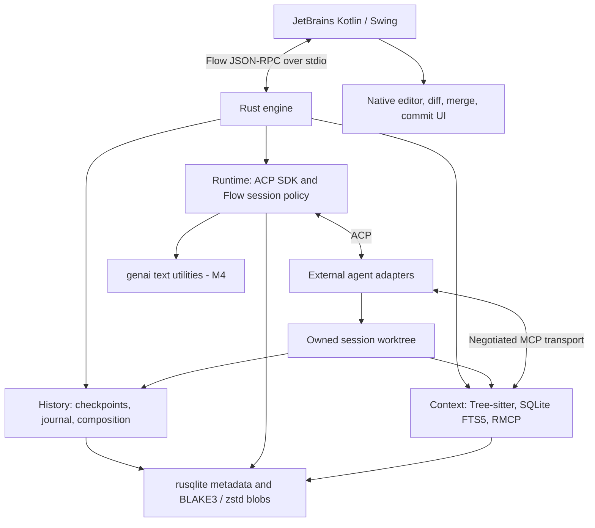

# Flow: Rust engine and native JetBrains agent workbench

Implementation plan · 2026-10-11 · Status: architecture accepted; implementation readiness conditional on feasibility gates

This plan builds Flow as an editor-independent Rust orchestration platform with a native Kotlin/Swing JetBrains client. Its first proof is a Codex task in an isolated worktree, two consecutive recorded edits to the same file, and two accurate historical diffs opened in the IDE. Trustworthy change history is the foundation for context, selective review, application, and productivity features.

This document is intentionally left uncommitted. Branch names below describe future implementation work; creating this plan does not create those branches or authorize release publication.

## 1. Repository baseline and scope

At initial inspection, the repository contained a Rust 2024 package named `flow`, version `0.1.0`, an empty dependency list, a lockfile, and a three-line `src/main.rs` that printed Hello World. There was no Cargo workspace, JetBrains integration, test harness, CI configuration, or pre-existing `docs` directory. The local `graft` directory contains a generated repository map, not a reusable context-engine implementation. Existing IDE/configuration changes are unrelated to this plan and must be preserved.

### Bootstrap progress

The requested initialization now supplies four core Cargo packages (`protocol`, `runtime`, `history`, `engine`), centralized core dependencies and a resolved workspace lockfile, Rust 1.99.0 tooling, and a native JetBrains plugin scaffold with the standard Gradle wrapper. Rust formatting, compilation, Clippy and the stderr-only engine bootstrap pass. The initial plugin configuration targets IntelliJ IDEA 2025.3.6.1 with Kotlin 2.2.20 and JDK 21; plugin compilation and IDE launch remain unverified because the initialization sandbox blocks Gradle's lock-coordination socket.

This is partial B02 foundation work authorized separately from the feasibility experiments. It does not satisfy G0 or implement production agent sessions, IPC, history persistence or the IDE bridge. CI and packaged validation remain pending. The context crate and later dependencies remain deferred as specified below. See the root README for build commands; the plan is still uncommitted.

### B02 progress — 2026-10-12

The user authorized continuing with the build foundation while B01's remaining checks stay recorded. The [B02 runbook](build-foundation.md) covers macOS arm64 CI, a registered Rust bootstrap integration target, Kotlin formatting, strict Gradle locking, checksum-baseline generation and Plugin Verifier for the pinned IDEA build. Rust checks and the user's native baseline build pass; the generated lockfile/checksum metadata and [native evidence](b02-native-baseline-evidence.json) are retained. Three native tests pass, and Plugin Verifier reports compatibility with four deprecated and six experimental API usages. [Strict verification without generation flags](b02-native-strict-evidence.json) now passes on the user's host; the first clean-checkout CI run remains pending. No production agent or IPC behavior is added. G0 is not declared complete by this sequencing decision.

### B01 progress — 2026-10-12

The [compatibility runbook](compatibility-spikes.md) records 17 passing fixture experiments, three passing native platform tests, the built plugin ZIP and manual historical diff, merge Apply/Cancel and project-close cleanup evidence. The user's host runs IDEA IU-253.33813.55; configuration verification completed with a warning about the intentional 253-only compatibility limit. The tested Unix `exec` launcher supplies cwd and an environment allowlist while preserving SDK process ownership and the parent's cwd; B08 can reuse this approach. All six real Codex ACP 0.5.2 probes now pass on the user's host with the per-run `gpt-6-astra` model override. The [retained report](b01-host-real-astra-evidence.json) verifies existing authentication, real writing, one-time permissions, exact edit/shell checkpoints 0/1/2 and cancellation acknowledgement. The background case records only baseline/final contents and no post-turn change; active-shell termination and fresh browser/device login are not proven. The initial workflow uses an already-authenticated external adapter. The assistant-environment macOS panic is a separate execution limitation. Adapter release provenance and plugin-unload cleanup remain open before G0. The [ADR](adr/0001-b01-agent-and-host-boundaries.md) retains scope and framework decisions. This evidence update does not commit the plan.

### Release boundaries

V1 means the first usable local workbench, not the entire product roadmap. The architecture stays Rust + Kotlin/Swing + ACP, with immutable history and native review. Only Phase 0 is ready to start unconditionally; later work is released for implementation by its evidence gate.

| Milestone | Included | Explicitly excluded from its exit gate |
| --- | --- | --- |
| M0 — Feasibility | One pinned Codex adapter, one IntelliJ IDEA build and one desktop OS/architecture; prove capture, lifecycle and native diff/merge APIs | Claude, context parsers, MCP transport production code, commit-selection APIs |
| M1 — Architecture proof | Clean commit worktree, one active writing session per project, durable history, cancellation/recovery and two historical native diffs | Main-project application, local-edit import, upstream conversation resume |
| M2 — V1 usable release | M1 plus review and application of the complete session result, native conflict resolution, integrity/performance gates and packaged installation on the M0 target | Selective operation/group application, multi-session execution, AI utilities and additional platforms |
| M3 — Context and integration follow-up | Worktree-specific Rust structural context, automatic read-only MCP attachment; independently deliverable dirty-baseline import and Claude support | Kotlin graph support, semantic summaries, full cross-language reference resolution |
| M4 — Productivity follow-up | Reviewed prompt enhancement and native message generation for an exact staged-index selection | Arbitrary JetBrains partial-selection modes, autonomous commits |

M3 and M4 are proposed follow-ups, not promises required to finish M2. Built-in context remains the first planned product expansion, implemented in Rust and attached automatically when that milestone ships. Each follow-up must pass its own acceptance gate; it cannot delay V1 by becoming an implicit prerequisite.

V1 may retain and reopen historical sessions, but permits only one active writing session per project. It starts at a captured commit, excludes local changes explicitly, and still protects all existing main-project disk, index and unsaved-document changes during application. Excluding dirty-baseline import does not relax preservation of dirty application targets. Reopening local history is required; resuming the external conversation is deferred.

V1 records observed file bytes and modes, including non-text effects where supported, but may block application of unsupported binary/type/mode conflicts. Selecting an operation opens its historical diff; it does not imply that operation can be applied or rejected independently. The user reviews and accepts/rejects the complete candidate result.

### Deferred scope

Named follow-up branches cover selective composition, concurrency/resume, automatic retention/GC, additional languages/transports, partial commit selection and platform expansion. VS Code and Zed clients, semantic LLM summaries, remote development/WSL, network-hosted state directories, non-Git writing sessions, multi-repository transactions, a general plugin SDK, vector storage, microservices, and a replacement coding agent remain outside V1. Unsupported repository shapes must be diagnosed, not silently treated as ordinary repositories.

### Review changes and rationale

The supplied review identifies an oversized first release and dependencies that should move earlier, but does not specify an exact reordered backlog. The milestone cut and ordering below are this plan's proposed resolution.

| Concern | Plan change |
| --- | --- |
| Too many features bundled into V1 | Separate M1 proof, M2 usable release, and M3/M4 follow-ups; add milestone labels to every numbered branch |
| Recovery arrives after both agents/context/apply | Narrow B25 to core recovery and require it, with B14 lifecycle, before B10 real-agent integration; B19 adds apply-specific recovery before any main-project writes ship |
| Application waits for dirty import and selective groups | B18 freezes the complete result; B19 applies it safely from a clean baseline; B13 import and selective composition follow later |
| Second agent coupled to context | B24 reuses the proven core without depending on B17; context interoperability is checked when both features are present |
| Packaging and performance feedback arrive too late | B28 packages the initial target after B06; B27 measures the first slice; B29 joins these with application and adversarial checks |
| Feasibility work itself becomes a large project | B01 tests M0 blockers and briefly inventories SDK proxy/Conductor support; parser/MCP experiments belong to B15/B17, commit-selection experiments to B22 |
| Too much custom integration machinery | B08 integrates the ACP client/process SDK, B17 integrates RMCP, B20 uses genai, and B03 uses standard serialization/framing; Flow implements product behavior around them |

## 2. Research findings and decisions to verify

Sources were checked on 2026-10-11. URLs tracking `main` or `latest` are evidence of the current design, not version pins. Phase 0 must record released versions and immutable revisions for implementation.

| Area | Finding and planning consequence |
| --- | --- |
| ACP Rust support | Checked docs list `agent-client-protocol` 3.3.0, including optional `process` support. Use its stable client/session APIs and process component; SDK support does not prove adapter write boundaries or complete process-tree cleanup. [ACP API](https://docs.rs/agent-client-protocol/latest/agent_client_protocol/), [3.3.0 features](https://docs.rs/crate/agent-client-protocol/3.3.0/features) |
| ACP extension packages | The SDK repository includes proxy/Conductor, cookbook, RMCP integration and test packages. Native MCP-over-ACP is opt-in under `unstable_mcp_over_acp`; assess release compatibility before adopting those packages. [Official SDK repository](https://github.com/agentclientprotocol/rust-sdk) |
| MCP SDK | RMCP is the official Rust MCP SDK; checked feature docs list 3.5.1 with server, macro, stdio and streamable HTTP options. B17 implements tool handlers through it, not another MCP protocol. [RMCP repository](https://github.com/modelcontextprotocol/rust-sdk), [3.5.1 features](https://docs.rs/crate/rmcp/3.5.1/features) |
| LLM utilities | Checked docs list genai 0.6.5, a provider client with chat and authentication configuration. Select it for B20 text generation; provider/model compatibility is verified there. [genai API](https://docs.rs/genai/0.6.5/genai/) |
| IDE library reuse | Use platform-bundled coroutines; Kotlin UI DSL is for settings/forms, while the interactive workbench uses Swing components. [Coroutines](https://plugins.jetbrains.com/docs/intellij/kotlin-coroutines.html), [Kotlin UI DSL](https://plugins.jetbrains.com/docs/intellij/kotlin-ui-dsl-version-2.html) |
| Codex adapter | The previous Zed repository is archived and directs new users to `agentclientprotocol/codex-acp`. The maintained adapter uses Codex App Server and advertises client MCP support. Validate its released package, runtime prerequisites, auth, and event behavior rather than following old binary-install instructions. [Migration notice](https://github.com/zed-industries/codex-acp), [maintained adapter](https://github.com/agentclientprotocol/codex-acp) |
| Claude adapter | The maintained `claude-agent-acp` integrates the Claude Agent SDK. Treat it as an adapter-specific integration, with its own capabilities and runtime requirements. Do not assume every interactive Claude Code feature is reproduced. [Claude adapter](https://github.com/agentclientprotocol/claude-agent-acp) |
| MCP attachment | ACP session creation carries a working directory and MCP server descriptions. Session loading is capability-dependent. Prefer negotiated standard MCP attachment; do not make experimental MCP-over-ACP proxy features a V1 prerequisite. [ACP session setup](https://agentclientprotocol.com/protocol/v1/session-setup) |
| Tool attribution | ACP reports tool status and content. Flow must measure event ordering and verify actual filesystem effects; reported diffs are evidence, not authoritative snapshots. [ACP tool calls](https://agentclientprotocol.com/protocol/v1/tool-calls) |
| JetBrains lifecycle | Project services can receive lifecycle-bound coroutine scopes. Use these for bridge supervision and keep constructors lightweight. [Services](https://plugins.jetbrains.com/docs/intellij/plugin-services.html) |
| JetBrains UI | Tool windows and native diff facilities are available. Prove exact APIs against the selected SDK, including merge and commit integration. [Tool windows](https://plugins.jetbrains.com/docs/intellij/tool-windows.html), [DiffManager API source](https://raw.githubusercontent.com/JetBrains/intellij-community/master/platform/diff-api/src/com/intellij/diff/DiffManager.java) |
| Threading | Editor/PSI access and UI updates have platform locking/threading constraints. Keep transport, Git, parsing, and hashing away from the EDT and use supported read/write mechanisms. [Threading model](https://plugins.jetbrains.com/docs/intellij/threading-model.html) |
| Commit selection | JetBrains supports selected chunks and individual lines. A path list or `git diff HEAD` cannot establish exact selection. Public API feasibility is a B22 entry spike; staged-index mode is the initial scope. [Commit documentation](https://www.jetbrains.com/help/idea/commit-and-push-changes.html) |
| Storage | WAL permits concurrent readers but retains a single writer and requires suitable local storage. Adopt one serialized writer and a local application data directory. [SQLite WAL](https://www.sqlite.org/wal.html) |
| Isolation | Worktrees separate working directories and indexes while sharing repository infrastructure. They are not process or security sandboxes. [Git worktree](https://git-scm.com/docs/git-worktree) |
| Context | Tree-sitter provides incremental syntax trees. Semantic cross-file resolution is an additional, language-specific layer and cannot be inferred from parsing alone. [Tree-sitter](https://tree-sitter.github.io/tree-sitter/) |
| Transport | JSON-RPC defines messages, not Flow's stream framing or replay contract. MCP has its own transport rules; keep these boundaries explicit. [JSON-RPC specification](https://www.jsonrpc.org/specification), [MCP transport specification](https://modelcontextprotocol.io/specification/2025-06-18/basic/transports) |

Graft is a product inspiration supplied in the brief. No particular upstream Graft repository or license is assumed; implement the structural-context design independently unless a later dependency review identifies a specific reusable project.

## 3. Architecture and ownership



Rust owns durable state, session behavior, history, diff inputs, composition, context, and Git planning. Kotlin owns host interaction and a disposable projection of engine state. It may cache UI rows and immutable content, but must reconstruct them from Rust after reconnecting. Only UI preferences belong in Kotlin persistence.

For changes to the main project, Rust prepares a versioned application plan; Kotlin applies open-document edits through supported IDE write commands. Rust never races the IDE by independently overwriting those documents. Closed-file and binary changes use a coordinated host filesystem/VFS path. The host reports actual results; Rust reconciles and records completion. Multi-file application is recoverable, not falsely described as an OS-wide atomic transaction.

### Target repository layout (create incrementally)

```text
Cargo.toml                         # virtual workspace; retain Flow branding
Cargo.lock
rust-toolchain.toml
crates/
  protocol/src/                    # serde DTOs, errors, schemars JSON Schema
  runtime/src/                     # ACP SDK integration, session policy, Git, genai (M4)
  history/src/                     # rusqlite, BLAKE3/zstd; Flow checkpoints/diffs/apply
  context/src/                     # Tree-sitter/ignore, FTS5, RMCP handlers (M3)
  engine/src/                      # Tokio executable, tokio-util IPC, tracing, wiring
integrations/jetbrains/
  build.gradle.kts
  settings.gradle.kts
  gradlew / gradlew.bat / gradle/
  src/main/kotlin/dev/flow/
    bridge/                        # EngineService, RpcClient, generated DTOs
    ui/                            # workbench, sessions, operations, prompts
    ide/                           # editor context, native diff/merge, commit selection
    actions/
  src/main/resources/META-INF/plugin.xml
  src/test/
schema/                            # versioned Flow wire contract and golden examples
tests/fixtures/                    # repositories, fake ACP agent, crash scenarios
tests/integration/                 # registered Cargo integration-test target
benchmarks/
scripts/                           # build, validate, package
docs/adr/                          # implementation decisions created in future branches
.github/workflows/
```

The target has five production Rust crates. B02 creates only `protocol`, `runtime`, `history`, and `engine`; B15 adds `context` when M3 starts. Do not create empty context modules, future utility services or future RPC handlers in M0/M1. `protocol` has no IDE or agent dependencies. `history` owns the initial storage/migration facade; runtime and context register their versioned tables through it. It must not import ACP, runtime, or Kotlin concepts. Engine wires runtime, history, and eventually context; use narrow test seams where needed so history tests run without agents, without creating a plugin framework. If storage deserves a separate crate later, extract it for a demonstrated ownership need.

### Framework stack and ownership

Select these libraries as the implementation defaults; pin tested releases/features in the branch that introduces them. The version observations in section 2 are research evidence, not proof that this combination builds. Keep the five-crate target and create dependencies incrementally.

| Area | Framework / library | Introduction | Flow still owns |
| --- | --- | --- | --- |
| Native UI and integration | IntelliJ Platform SDK, Kotlin/Swing; platform coroutines | B02/B06; native diff B11, merge B19 | Host actions, presentation, document/version coordination |
| Agent connection | `agent-client-protocol` 3.x with `process` | B01 spike, B08 production; B05 test harness as needed | Agent profile configuration, workspace binding, durable lifecycle and approval presentation |
| Async runtime | `tokio`; only required features | B03 engine/IPC, B07 Git tasks | Task supervision, bounded queues and shutdown policy |
| Flow IPC | `serde`, `serde_json`, `tokio-util` with `codec`; `schemars` | B03 | Small request router, app version negotiation, event replay and idempotency |
| Durable state | SQLite through `rusqlite` with `bundled` | B04 | Schema/migrations, transaction ordering, integrity and recovery |
| Immutable bytes | `blake3`, `zstd` | B04 | Snapshot manifests, durable publication, checkpoint comparison and attribution |
| Source discovery | `ignore` | B07/B09 where useful; reused by B15 | Exact history coverage rules, exclusions and path authorization |
| Structural context | `tree-sitter`, `tree-sitter-rust` | B15 | Queries, graph identity, incrementality, confidence and freshness |
| Retrieval | SQLite FTS5 through the existing SQLite build | B16 | Bounded symbol/path/text ranking, provenance and relevance evaluation |
| Agent-facing tools | `rmcp` 3.x, server/macros plus one transport | B17 | Read-only context functions, session scope and content budgets |
| Text utilities | `genai` 0.6.x | B20 only, M4 | Utility prompts, exact inputs, review flow and cancellation outcome handling |
| Diagnostics | `tracing`, `tracing-subscriber` (`env-filter`) | B03; spans added with each feature | Correlation IDs, redaction, bounded stderr logs and diagnostic export |
| Test support | `tempfile`; compatible ACP SDK test utilities where published/usable | B04/B05 | Filesystem scenarios, failure injection and independent manifest oracles |
| Change hints | `notify` | After B27 only if measurements justify it | Reconciliation remains authoritative |
| Git | System Git executable | B07 | Typed command arguments, ownership/preconditions and safe application planning |

Do not add Rig/LangChain/LangGraph agent orchestration, a second ACP/MCP implementation, a custom provider HTTP layer, Tauri/Iced/Dioxus UI, gRPC or `git2` to this path. No standalone HTTP application framework is needed for V1. If RMCP's selected HTTP transport later needs a server host, use its supported integration with the smallest required host; avoiding a named dependency must not lead to writing HTTP by hand. No vector database is planned.

The SDK handles ACP messages, sessions, streaming and permission request/response mechanics. The external agent retains its execution/authentication and permission enforcement. Flow routes decisions to the native UI, rejects stale responses, persists product state and supervises owned processes; these are application responsibilities, not a replacement execution or permission framework. SDK/proxy events never substitute for verified filesystem observations.

RMCP supplies MCP framing/dispatch/schema and standard transport machinery. Flow supplies the graph queries and their access policy. `genai` supplies provider communication; Flow supplies bounded text-only requests and accepts no tool-execution loop. Native diff rendering and merge interaction remain with JetBrains.

### Runtime and storage integration constraints

Use the ACP SDK's process component as the single owner of an agent subprocess where its tested API permits it. Tokio owns Flow's runtime and non-agent tasks; do not also spawn the same adapter with `tokio::process`. B01 must prove executor/I/O interoperability and document any small required bridge. The ACP `process` feature uses its own async process dependencies, so using Tokio alone is not evidence of integration compatibility. [ACP feature dependencies](https://docs.rs/crate/agent-client-protocol/3.3.0/features)

Use one dedicated database writer thread for `rusqlite`, with bounded request channels and separate bounded reads as needed. Hashing, compression, parsing and short blocking reads can use bounded `spawn_blocking` work. Cancellation must be cooperative or leave an explicit unknown/incomplete outcome; aborting an async waiter does not stop already-running blocking work. [rusqlite API](https://docs.rs/rusqlite/latest/rusqlite/), [Tokio blocking-task behavior](https://docs.rs/tokio/latest/tokio/task/fn.spawn_blocking.html)

FTS5 indexes are derived context data, updated consistently with the graph generation and rebuildable from source. Verify that the packaged SQLite build supports FTS5 with a create/query test; do not assume every SQLite distribution enables it. Keep symbol equality and path ranking deterministic alongside full-text search. [SQLite FTS5](https://www.sqlite.org/fts5.html)

For Flow IPC, use a maximum-length `LinesCodec` rather than implementing stream splitting. Malformed or oversized frames invalidate the connection; do not resume ambiguous mutation traffic after discarded input. `schemars` generates JSON Schema, not Kotlin source: B03 must prove the small Kotlin DTO generation step or use schema-checked DTOs with cross-language golden tests. [LinesCodec](https://docs.rs/tokio-util/latest/tokio_util/codec/struct.LinesCodec.html), [schemars](https://docs.rs/schemars/latest/schemars/)

### Dependency introduction recipe (future implementation only)

The current repository has none of the workspace packages below. These commands are documentation for their owning branches, not commands to run while editing this plan. Use `[workspace.dependencies]` for shared versions/features and inherit them in consuming crates; the commands illustrate the intended package ownership before that normalization.

```sh
# B03: engine and Flow protocol, after B02 creates the packages
cargo add -p engine tokio --features rt-multi-thread,macros,io-std,io-util,sync,time
cargo add -p engine tokio-util --features codec
cargo add -p engine serde_json tracing
cargo add -p engine tracing-subscriber --features env-filter
cargo add -p protocol serde --features derive
cargo add -p protocol serde_json schemars

# B04: history storage; B05 reuses temporary-repository support
cargo add -p history rusqlite --features bundled
cargo add -p history blake3 zstd
cargo add -p history tempfile --dev

# B07/B08: Git orchestration, discovery, ACP SDK integration
cargo add -p runtime tokio --features process,io-util,sync,time
cargo add -p runtime agent-client-protocol@3 --features process
cargo add -p runtime tracing ignore

# B15/B16: context crate is created only at M3
cargo add -p context tree-sitter tree-sitter-rust ignore
# Context SQL uses the existing rusqlite storage facade; no second SQLite library.

# B17: initial standard stdio MCP transport
cargo add -p context rmcp@3 --no-default-features --features server,macros,transport-io
# HTTP features are added only if the selected adapter requires HTTP.

# B20: utilities are added only at M4
cargo add -p runtime genai@0.6
```

Add direct imports such as serde/tracing to a crate only when it uses them; do not rely on transitive dependencies being importable. B05 first checks the SDK's released test package/API and version alignment. Reuse available fixtures; keep a small scripted filesystem scenario driver for Flow-specific faults, rather than requiring unreleased test helpers or rebuilding ACP.

These ranges are not an exact tested lock. At each introduction: resolve against the pinned Rust toolchain, inspect default/optional features and duplicate SDK/schema versions, build/test, record the resulting versions in the compatibility manifest, and commit the implementation's `Cargo.lock` with that branch. CI uses `--locked`. The plan itself remains uncommitted. Avoid blanket Tokio `full` and ACP `unstable` features; enable `process`, RMCP transports and any later compatibility package only where needed.

## 4. Correctness contracts to establish before features

### 4.1 Durable model

This table describes the eventual model, not a requirement to create every table in B04. M1 implements repository/workspace, session/turn, event, snapshot, operation and file change records. B18/B19 add full-result candidate and apply records; logical groups, context generations and utility records arrive with their owning follow-up features.

| Entity | Required identity and fields |
| --- | --- |
| Repository / workspace | Stable repository ID, canonical root and common Git directory, workspace ID, ownership marker, worktree path, base commit, lifecycle state |
| Session / turn | Session and turn IDs, agent and adapter versions, upstream IDs, negotiated capabilities, baseline snapshot, prompt provenance, status, timestamps |
| Event | Database-wide monotonic sequence, schema version, workspace/session/turn IDs, type, payload, upstream ID when available, durable timestamp |
| Snapshot | Immutable manifest ID, workspace ID, sorted path entries, byte-content IDs, modes/types, completeness/exclusion manifest, capture interval, provenance |
| Operation | ID, session/workspace/turn, local sequence, tool ID, parent/group IDs, start/end snapshots, status, attribution class/evidence, capture interval |
| File change | Old/new paths, before/after blob IDs, before/after type and mode, size, encoding hint, change kind; renames may be inferred |
| Logical change | Stable group ID, member operations, user label, known dependencies, confidence and review status |
| Candidate / review | Immutable selection version, baseline, included groups/operations, result manifest, conflicts, validation results tied to result hash |
| Apply transaction | Idempotency key, candidate hash, expected HEAD/index/disk/document versions, intended writes, preimages, per-file receipts, recovery status |
| Context generation | Workspace, manifest/content hash, parser/query versions, files/symbols/edges, confidence/source, freshness and incomplete-index status |
| Utility request | Purpose, provider/model, input/selection hashes, context references, output, cancellation/error state; no stored credentials |

Represent path bytes losslessly where the OS permits non-UTF-8 names; define a wire-safe encoding and separate display name. Never coerce distinct paths into the same lossy string. Store exact bytes and type/mode independently of text rendering. Empty files and absent files are different states. IDs are opaque; timestamps do not determine event ordering.

### 4.2 Persistence and recorder invariants

1. Hash original bytes, compress blobs, write a temporary object, flush it, then publish it under its content address. Version compression metadata separately from the content hash.
2. Commit operation metadata, manifest references, checkpoint advancement, and the durable event in one SQLite transaction only after referenced blobs are durable. Emit `operation.recorded` after commit.
3. Use WAL, foreign keys, migration versioning, bounded busy retries, and an explicit durability setting. Start with `synchronous=FULL` for authoritative history; measure before changing it.
4. Recovery tolerates unreferenced blobs but never treats missing referenced content as valid history. Mark damage, retain evidence, and disable affected application paths.
5. The recorder compares actual workspace content with the last verified checkpoint. Tool-reported changes are hints for attribution and prioritized scanning.
6. Start with explicit boundary scans; optional watcher events later accelerate discovery; reconciliation at initialization, reliable operation boundaries, turn completion/cancellation, and restart establishes coverage. Watcher overflow forces a rescan.
7. Atomic means a durable historical observation with immutable before/after content. It does not promise capture of every transient filesystem write or a globally atomic filesystem snapshot.
8. Serialize controlled writes when the adapter allows it. One active prompt cannot force external subagents or background shell writers to serialize. Use bounded stable-read retries, detect overlapping writers, and record grouped/interval attribution when precise boundaries are unavailable.
9. Attribution is explicit: `exact-controlled`, `correlated`, `interval-observed`, `external`, or `unknown`. A successful tool event with no disk delta remains an operation with no changes; a failed tool can still have real changes.
10. Track regular tracked files and eligible untracked files. Always exclude Git internals and Flow state. Define generated/ignored-file policies and report omissions, size limits, unstable reads, and unsupported file types. Do not label an incomplete checkpoint complete.

Session states include `preparing`, `ready`, `running`, `awaiting_permission`, `cancelling`, `interrupted`, `failed`, and `closed`. Turns have their own terminal states. Tool completion, model turn completion, recorder completion, and application completion are separate facts. A turn becomes ready for review only after reconciliation, or displays an explicit incomplete-capture state.

### 4.3 Baselines and review semantics

- Start from a captured commit OID, not a branch name that can move during preparation. A clean session excludes current local edits by explicit choice.
- M3 import mode captures HEAD, the real index, disk state, and selected untracked contents independently. Materialize the approved local overlay into the worktree without altering the user's index. Preserve provenance for staged and unstaged edits on the same file.
- Revalidate HEAD/index/content after capture to detect races. Dirty editors require an explicit save decision or exclusion. V1 does not implicitly import unsaved buffers; virtual-buffer baselines are deferred.
- When M3 import mode ships, imported local edits belong to the baseline. The proposed agent delta is `candidate minus imported baseline`, so pre-existing changes are not mislabeled as agent work.
- Preserve operations for the retained session. V1 can reject the complete candidate without changing history or the live agent workspace. Independent group selection arrives only in the selective-composition follow-up.
- In V1, freeze the verified complete session result as a candidate. In the selective-composition follow-up, compose selected changes in a scratch candidate using their original preimages and deterministic order. Detect textual/preimage conflicts and known dependencies. Arbitrary semantic independence is unprovable; passing a merge is not a correctness guarantee.
- Apply using the baseline, candidate, and freshly captured current project. Preserve unrelated current edits and the existing Git index. Route unresolved conflicts through native merge UI and revalidate after resolution.
- Block application while the session is still writing, the candidate is stale, captures are incomplete, or expected target versions have changed. Recomposition creates a new candidate version.

### 4.4 Flow protocol

The method list is a roadmap: B03 implements only M1 methods, B18/B19 add candidate/apply methods, and M3/M4 add context/utilities. Unsupported method families remain unadvertised; do not generate empty handlers or require future DTOs in the first slice.

Use versioned JSON-RPC 2.0 with newline-delimited UTF-8 JSON for Flow IPC. Encode embedded newlines; one writer owns stdout. Set a maximum frame size and fetch large blobs in bounded chunks. Keep stderr separate and redact logs.

| Method family | Responsibilities |
| --- | --- |
| `engine.initialize`, `engine.health`, `engine.shutdown` | Protocol range, engine build, host capabilities, project identity, connection epoch, health and disposal |
| `agents.list`, `agents.validate` | Executable configuration, detected version, runtime dependencies, supported capabilities |
| `sessions.create/list/get/close`, `turns.start/cancel` | Durable lifecycle, explicit baseline choice, accepted prompt and cancellation |
| `permissions.respond` | One-time resolution tied to live request, session, and adapter epoch |
| `events.subscribe/replay`, `state.get` | Durable cursor replay and consistent state snapshot with high-water sequence |
| `changes.list/open`, `blobs.read` | Paginated immutable history, historical content, byte ranges and integrity metadata |
| `reviews.update`, `candidates.compose/validate` | Versioned review choices, conflicts and candidate-bound validation |
| `apply.prepare/status/complete` | Preconditioned host apply plan and verified transaction receipts |
| `context.query/status/refresh` | Bounded retrieval, indexing progress and workspace freshness |
| `utilities.enhancePrompt/generateCommitMessage/cancel` | Isolated text generation tied to input hashes |

Persist mutation idempotency keys and request outcomes. A transport timeout means outcome unknown, not failed; query status before retrying. Engine epochs distinguish stale replies. Reject incompatible major versions and negotiate additive features within a compatible version.

Snapshot plus high-water sequence must come from a consistent read. Subscribe/replay from that sequence without a race; deduplicate by sequence. Bound queues, paginate replay, and force snapshot resynchronization if a cursor was pruned. Coalesce display-only streaming chunks while durably sealing final messages; never drop history, permissions, or mutation outcomes. No RPC wait occurs on the EDT.

## 5. Branch workflow and implementation phases

Keep the original B01–B29 identifiers for traceability. B08 is renamed from `feat/acp-agent-host` to `feat/acp-sdk-integration`, and B17 from `feat/session-context-mcp` to `feat/rmcp-context-integration` to make framework ownership explicit; the other branch names remain stable. Their numbers no longer imply execution order: use the dependency ledger and milestone gates. A branch name identifies a deliverable, not a promise to implement the whole roadmap before the first release. B14, B18, B25–B29 have deliberately narrower scope than the initial draft.

Branch from the integration branch after direct prerequisites merge and the milestone entry gate permits work. Each branch includes its own tests and documentation. `test/` branches add cross-feature evidence rather than postponing feature tests. Keep merges buildable, preserve unrelated user changes and leave this plan uncommitted.

### Phase map and stop/go decisions

| Phase | Milestone / branches | Exit gate and next decision |
| --- | --- | --- |
| 0 — Feasibility and foundation | M0: B01–B02 | G0: core adapter/native API probes pass; pin the one-target support matrix before implementing the slice |
| 1 — Core history proof | M1: B03–B09, B25, B14, B10–B12 | G1: two real observed edits survive restart; cancellation and core recovery pass; freeze M2 scope and re-estimate |
| 2 — Usable V1 | M2: B18–B19, B26–B29 | G2: full-result apply preserves dirty targets, integrity/performance pass and final packaged artifact passes acceptance |
| 3 — Context and integration follow-up | M3: B15–B17, B13, B24 | G3: automatic worktree context passes; import and Claude independently pass their extension regressions |
| 4 — Productivity follow-up | M4: B20–B23 | G4: enhancement preserves intent and supported commit input is exact |

B28 starts after B06 as an early packaging smoke; B27 starts after G1. Neither waits for M3/M4. M2 is the required path after G1. M3/M4 production work starts after G2 unless an explicit replan allocates independent work without moving V1's gate. Technical prerequisites and release authorization are separate: the ledger does not use B29 as a fake code dependency for every follow-up.

Framework introduction follows these gates: IntelliJ/Tokio/serde first, ACP integration over the already-tested recorder, then RMCP/Tree-sitter at M3 and genai at M4. B01 may run a disposable SDK agent probe before persistence exists, but product writing sessions still wait for B09/B25. Whole-result safe application remains M2; only advanced selective composition is deferred.

At G0, failure to establish observable boundaries or safe native integration means narrow the supported workflow or stop that capability. At G1, failures in history integrity block application work. At G2, correctness failures block V1; deferred features cannot be substituted for missing evidence. Time estimates are refreshed at G0 and G1 rather than promised for all 29 branches upfront.

### Phase 0 — Feasibility and foundation

#### B01 — `chore/architecture-compatibility-spikes`

**Milestone:** M0.

**Depends on:** none. **Scope:** bounded feasibility experiments and ADRs for M0.

Tasks:

- Pin released Rust/MSRV, ACP SDK and Codex adapter versions, Kotlin/JDK, Gradle wrapper and IntelliJ tooling. Compile a minimal stable-v1 client/process example under the chosen Tokio runtime; record executor/I/O bridging, process cleanup behavior, feature flags, provenance and core dependency licenses.
- Within the existing spike budget, inventory the SDK proxy, Conductor, cookbook, RMCP integration/polyfill and test packages. Record released compatibility and stable versus opt-in APIs, plus the decision to use the client directly for V1. This is a documentation/example investigation, not proxy-chain implementation or a new release gate.
- Choose one local IntelliJ IDEA build and one available OS/architecture for the first release; record exact versions and repeatable launch instructions.
- In scratch experiments, prove native historical diff, merge-result retrieval, project disposal and background process handling through supported APIs. Commit UI and selection experiments move to B22.
- Probe Codex authentication, prompts, permissions, cancellation, two observable sequential edits, shell effects and overlapping/background writes in disposable repositories.
- Time-box each spike to two engineering days before a written continue/narrow/stop decision; this is a planning budget, not a delivery estimate. Record supported repository/file shapes and capture limitations.

**Validation:** Retain redacted traces, immutable version identifiers and a two-boundary capture demonstration. Demonstrate native immutable diff inputs and resolved merge content. M0 passes only when each core unknown has evidence or an explicit safe scope cut.

**Risk:** If precise tool attribution fails, keep honest interval attribution. If no reliable two-boundary scenario or safe native merge path exists, M0/M2 respectively remains blocked; do not replace evidence with a large implementation commitment. Claude/MCP/commit spikes do not block M0.

#### B02 — `chore/workspace-and-build-foundation`

**Milestone:** M0.

**Depends on:** B01. **Scope:** root manifests, four core crates, Gradle project, CI.

Tasks:

- Replace the Hello World package with the planned workspace and `flow-engine` binary; preserve the project name in user-facing metadata.
- Add Gradle wrapper, plugin descriptor, development launch configuration, pinned toolchains, Rust formatting/lint policy, Kotlin formatting, and dependency lock/verification configuration. Use the Kotlin coroutines library bundled with the pinned IntelliJ Platform; do not package a competing version.
- Register a real Cargo target for `tests/integration`; a root test directory alone is not discoverable in a virtual workspace.
- Add required native checks for the selected M0 platform, Gradle tests, protocol fixtures and plugin verification for the pinned IDE build. Additional platform build checks are optional feedback, not a support promise.
- Document developer setup and commands; reserve external app-data paths and a test-only temporary-data override.

**Validation:** clean checkout builds Rust and the empty plugin; `runIde` starts; required CI jobs execute rather than reporting zero discovered tests.

**Risk:** native packaging and Kotlin/JDK compatibility can diverge; keep release artifacts disabled until B28.

### Phase 1 — Core history proof

#### B03 — `feat/versioned-engine-protocol`

**Milestone:** M1.

**Depends on:** B02. **Scope:** `protocol`, engine RPC, schema fixtures.

Tasks:

- Define typed IDs, methods, events, errors, host capabilities, handshake, framing, cancellation, and forward-compatible optional fields.
- Define Rust DTOs with serde/serde_json and export schema with schemars. Prove Kotlin generation separately (schemars does not generate Kotlin); if a generator is unsuitable, enforce schema/golden-fixture checks for the small Kotlin DTO set. Pin schema output changes in review.
- Integrate Tokio and tokio-util bounded line framing, serde_json decoding and a small Flow request router. Add correlation IDs, timeouts, a single stdout writer, tracing/tracing-subscriber on stderr, redaction and protocol-version rejection; leave ACP/MCP routing to their SDKs.
- Define persistent-event/idempotency interfaces; B04 supplies storage and B06 exercises reconnect behavior.

**Validation:** Rust/Kotlin golden round trips; split/coalesced frames, malformed JSON, Unicode, oversized payloads, unknown enum values, EOF, late replies and incompatible versions.

**Risk:** replay and retry semantics become costly to retrofit; mutation outcome/status must exist before real tasks.

#### B04 — `feat/immutable-history-storage`

**Milestone:** M1.

**Depends on:** B03. **Scope:** history store, migrations, content objects.

Tasks:

- Use rusqlite with bundled SQLite for M1 model tables and a dedicated writer thread; use blake3/zstd for immutable content. Implement Flow manifests, durable publication, event sequences and mutation receipts around those libraries.
- Implement blob publication before metadata commit, hash verification, schema migration backup, and startup integrity checks.
- Store data outside repositories; use per-project databases/blob directories and explicit session/worktree ownership records.
- Add paginated history queries, chunked content reads and explicit missing/corrupt-content errors.

**Validation:** byte-for-byte round trips for text/binary/empty files; deduplication; mode/type differences; crash injection at publication and commit boundaries; referenced-object integrity after restart.

**Risk:** filesystem and SQLite do not share a transaction; orphan objects are tolerable, missing referenced objects are not.

#### B05 — `test/fake-agent-and-repository-fixtures`

**Milestone:** M1.

**Depends on:** B03, B04. **Scope:** deterministic harnesses.

Tasks:

- Reuse compatible released ACP SDK test utilities and tempfile for protocol fixtures and isolated repositories. Add only Flow-specific scripted write/crash scenarios; keep a narrow raw-stream injector for malformed-output tests that a conforming SDK cannot emit. Cover permissions, delays, cancellation resistance and partial writes.
- Provide fixture repositories for sequential edits, unreported shell writes, rename/delete/recreate, dirty index/worktree, conflicts, binary files, symlinks and unusual paths.
- Add independent content-manifest oracles and injected clocks/IDs; test results must not depend on a paid model.

**Validation:** harness creates and removes only owned temporary repositories; scripted traces are repeatable across runs; deliberately incorrect snapshots cause oracle failures.

**Risk:** a fake adapter can encode false assumptions; retain separate real-adapter compatibility smoke tests.

#### B06 — `feat/jetbrains-engine-bridge`

**Milestone:** M1.

**Depends on:** B03, B04, B05. **Scope:** project service, Swing shell, process lifecycle.

Tasks:

- Create `ToolWindowFactory`, a project-level engine service and background RPC supervision using platform-bundled coroutine scopes; start the sidecar lazily on use. Use JBList/JBTree/JBPanel/JBScrollPane and ActionSystem for the workbench, and Kotlin UI DSL only for settings/forms.
- Implement executable resolution, handshake, initial snapshot plus event replay, loading/disconnected states and bounded restart backoff.
- Update Swing models on the EDT; dispose listeners, coroutine jobs, pending requests, stream readers and child processes on project close/plugin unload.
- Add a native button that requests engine health and shows a result, plus fake-engine injection for tests.

**Validation:** open/close two projects, restart engine, reopen tool window, unload plugin and flood events without UI freezes, duplicate engine instances or orphaned processes.

**Risk:** losing a request response must not display a successful mutation; surface pending/unknown state until Rust resolves it.

#### B07 — `feat/isolated-session-worktrees`

**Milestone:** M1.

**Depends on:** B04, B05. **Scope:** runtime workspace/Git/session preparation.

Tasks:

- Use system Git through typed argv and controlled cwd/environment to discover repository identity/version and create an owned detached worktree at a fixed commit. Use ignore for eligible untracked discovery, but always enumerate tracked paths separately: a tracked file matching an ignore pattern must still be recorded.
- Implement clean-baseline choice, manifest capture, per-workspace writer lease and repository-level coordination for owned worktree administration.
- Persist preparation stages and clean up only proven owned incomplete worktrees. Retain interrupted workspaces for inspection.
- Reject unresolved indexes, unsupported sparse/submodule arrangements and path escapes with actionable errors; keep main HEAD/index/worktree unchanged.
- Detect the same repository opened by another engine using lock metadata, process identity and explicit stale-lock recovery.

**Validation:** compare main project bytes, HEAD and index before/after; fail midway through worktree creation; handle paths with spaces, branch movement, duplicate opens and stale ownership records.

**Risk:** linked worktrees share Git metadata and an external agent can run arbitrary Git commands; detect unexpected repository changes and document the isolation boundary.

#### B08 — `feat/acp-sdk-integration`

**Milestone:** M1.

**Depends on:** B03, B05, B07. **Scope:** thin ACP SDK client/process integration and Flow-specific callbacks.

Tasks:

- Integrate the official agent-client-protocol client/session APIs and process component proven in B01. Pass configured executable arguments through the SDK; use the proven Unix `exec` launcher for child cwd and controlled environment on the initial macOS target, or released SDK controls if verified. Retain one subprocess owner and never mutate the project engine's global cwd per session.
- Reuse SDK initialization, typed capabilities, session setup, streams, cancellation and permission exchanges. Implement only advertised host callbacks (terminal/filesystem where required) and Flow event mapping; retain upstream IDs and adapter-specific evidence.
- Forward SDK permission requests to Kotlin and the user's response back through the SDK. Add session/epoch binding and stale-request rejection; do not build an agent execution loop, authentication system or replacement permissions framework.
- Join SDK lifecycle signals to Flow's workspace ownership, durable session states and recorder hooks. Test SDK shutdown guarantees; add only missing process-tree supervision needed to prevent orphan writers.
- Keep proxies/Conductor and agent-client-protocol-rmcp out of the V1 runtime dependency path. No unstable protocol or native MCP-over-ACP feature is needed for the initial client.

**Validation:** run SDK-backed fake-agent contracts, then B10 real-adapter smoke; check Tokio/SDK interoperability, delayed/stale permission responses, tool failure with writes, process/child crash, unsupported capabilities, repeated cancellation and queue bounds. Verify there is no second custom ACP transport or duplicate subprocess owner.

**Risk:** advertise only client capabilities actually implemented; retain the agent's own restrictions and never infer approval from timeout.

#### B09 — `feat/workspace-operation-recorder`

**Milestone:** M1.

**Depends on:** B04, B05, B07, B08. **Scope:** history recorder and runtime capture hooks.

Tasks:

- Capture verified starting manifests, operation boundaries where reliable, turn boundaries, and externally observed changes.
- Start with full coverage reconciliation at explicit boundaries; stable-read retries detect files changed while hashing. Add watcher hints only after B27 demonstrates a need; they never replace reconciliation.
- Persist immutable before/after pairs, operation outcomes, attribution evidence, capture completeness and logical grouping hints.
- Support create/delete/rename inference, mode changes, binary data and partial effects of failed shell commands.
- Handle overlap by grouping intervals; a terminal event does not prove child/background writers have exited. Mark unstable sessions and prohibit safe-apply claims until quiescent.

**Validation:** three edits to one file reopen three distinct pairs; repeated write/revert between checkpoints is honestly unobservable; missing events, overflow, overlap, external edits and failed writes are not falsely attributed.

**Risk:** worktree observation cannot recover unseen intermediate content. Product labels and acceptance tests must preserve this limitation.

#### B25 — `feat/history-recovery-and-retention`

**Milestone:** M1.

**Depends on:** B04, B07, B08, B09. **Scope:** core capture recovery before real-agent integration; automatic retention is deferred.

Tasks:

- Reconcile incomplete worktree preparations, operations and session transitions on startup using actual manifests and owned-process records; never replay an unknown mutation automatically.
- Finish B04 durability checks with kill/restart tests around blob publication, metadata commit and checkpoint advancement; keep a read-only damaged-state mode.
- Add a storage budget and stop new writes safely when it is exhausted. Retain reachable history; offer explicit deletion of closed, owned sessions with active-reference checks.
- Define a recovery hook for new mutation types; B19 must implement apply-journal recovery before enabling application. Core recovery itself has no dependency on application, context or Claude.
- Keep automatic age policies, mark-and-sweep GC and broad migration tooling in the later retention branch; report local snapshot storage and deletion behavior clearly.

**Validation:** Disk full, locked DB, missing/truncated blob, engine kill during capture and missing worktree produce readable retained history or explicit damage. Recovery neither fabricates success nor overwrites newer workspace edits.

**Risk:** Delaying recovery until feature completion would invalidate first-slice trust. Storage exhaustion must fail closed without deleting live/reachable content.

#### B14 — `feat/session-lifecycle-and-resume`

**Milestone:** M1.

**Depends on:** B06, B08, B09, B25. **Scope:** single-active-session lifecycle and durable local-history reopening.

Tasks:

- Implement session list, local history reopen, close/archive and one active writing session per project. Keep session IDs/storage ready for multiple retained histories without building a concurrency scheduler.
- Persist lifecycle transitions and expire approvals on restart. An engine restart does not automatically restart a prompt or resume an upstream conversation.
- Track process ownership/background activity, reconcile on cancellation/close and release the writer lease only after shutdown is verified.
- Provide an explicit new-conversation action for retained workspaces when safe; upstream session load/resume and concurrent writers belong to a later named branch.

**Validation:** Fake-agent tests cover restart during permission wait/write, lost replies, duplicate events, close during work, second IDE opening the same repository and attempting a second active session. Local historical diffs remain available after restart.

**Risk:** Restarting the engine does not prove prior children stopped. Unknown process ownership blocks new writes; only read-only history is available until resolved.

#### B10 — `feat/codex-acp-integration`

**Milestone:** M1.

**Depends on:** B06, B08, B09, B14, B25. **Scope:** Codex profile and usable task loop.

Tasks:

- Add adapter executable settings, version/prerequisite diagnostics and the compatibility profile proven in B01.
- Support the adapter's advertised authentication handoff without copying its credentials into Flow history.
- Connect prompt submission, streamed activity, permissions, cancellation, task completion and recorded-change counts to Swing.
- Keep agent configuration and unsupported controls visible and accurate; do not promise resumable conversation if unadvertised.

**Validation:** opt-in real Codex task in a disposable worktree; authentication failure/retry, permission denial, cancellation and crash. Compare actual file effects against the recorded manifest.

**Risk:** behavior can change independently of Flow; supported adapter releases are explicit and unknown versions receive a compatibility diagnostic.

#### B11 — `feat/native-operation-history-review`

**Milestone:** M1.

**Depends on:** B06, B09, B10. **Scope:** timeline, file tree, native historical diff.

Tasks:

- Add session/turn/operation/file navigation with status, attribution, incomplete-capture indicators and pagination.
- Fetch immutable contents and construct native diff requests; prefer editor-area presentation supported by the selected SDK.
- Handle deletions, renames, non-text content, encoding and missing content without substituting the current disk file.
- Provide navigation from history to the current workspace with a clear distinction when the location has moved; historical diff content is read-only.

**Validation:** open earlier diffs after later edits, deleting the current file, engine restart and IDE restart; verify titles and bytes; keyboard navigation and accessibility checks.

**Risk:** displaying live file content under a historical label destroys trust; content IDs are part of the UI request identity.

#### B12 — `test/first-vertical-slice`

**Combined implementation authorized 2026-10-16:** the user combined B12, B27 and
B18 on the existing `feat/first-slice-performance` branch. Development and
measurement proceed together; unobserved B12 native host checks still prevent a
G1/release acceptance claim. See the [combined runbook](first-slice-performance-and-review.md).

**Milestone:** M1.

**Depends on:** B05, B10, B11, B14, B25. **Scope:** first release-blocking end-to-end scenario.

Tasks:

- Automate Swing task submission to a fake ACP agent that edits one file twice sequentially with observable completion boundaries.
- Assert two immutable historical pairs, no changes to the main project and accurate native diff requests before/after restart.
- Repeat the scenario manually with the pinned Codex adapter; record observed attribution granularity rather than imposing fake-agent assumptions.
- Include cancellation after the first write and a failed second write that nevertheless changes bytes.

**Validation / exit:** exact controlled pairs pass deterministically; real-agent observed checkpoints match disk states and carry honest attribution. If the adapter only yields one observable checkpoint, the real two-edit gate remains open until a reliable two-boundary scenario is demonstrated.

**Risk:** do not proceed to sophisticated selection UX while this gate fails.

### Phase 2 — Usable V1

#### B28 — `chore/native-engine-packaging`

**Milestone:** M2.

**Depends on:** B02, B06. **Scope:** early packaging smoke on the single V1 target.

**Platform expansion (authorized 2026-10-15):** build Windows x86-64, Linux
x86-64, Intel macOS and Apple Silicon macOS packages now, ahead of B29. Each
package must pass native startup and offline session/history/process-cleanup
acceptance in the CI matrix before that platform is advertised as validated.
See [native packaging](native-engine-packaging.md). B12 real-Codex evidence,
clean-machine installation, signing and B29 acceptance remain separate gates.

Tasks:

- Once B06 works, package the engine and plugin for the M0 OS/architecture and pinned IDE build; test outside the development checkout.
- Choose the matching executable deterministically, verify its digest inside a trusted distribution, and handle secure extraction, permissions and paths with spaces.
- Prove fresh-install startup/shutdown, prerequisite diagnostics and platform signing/distribution requirements before more features accumulate.
- Include version/protocol manifests and dependency/license inventory. Keep agent executables independently configured.
- Rebuild the package from the final M2 code for B29; early packaging success is not final release acceptance. Additional operating systems belong to platform-expansion work.

**Validation:** Clean-machine packaged bridge smoke passes on the chosen target without local build artifacts. Final candidate installation, agent behavior and upgrade/recovery are rechecked by B29.

**Risk:** A development checkout can hide missing binaries and runtime dependencies. Build success on other targets is not advertised support.

#### B27 — `test/performance-and-context-quality`

**Milestone:** M2.

**Depends on:** B12. **Scope:** early recorder/history/UI performance baseline; context quality moves to B16.

Tasks:

- Benchmark the first slice on named 1k/10k/100k-file fixtures, recording hardware, bytes, cold/warm state and exclusions.
- Measure full scans, incremental observed capture, history growth, native diff loads, event backlog, cancellation and UI responsiveness before adding context or selective composition.
- Simulate long history and replay; validate bounded queues, pagination and storage-budget behavior.
- Optimize measured bottlenecks only. Add watcher hints if scanning exceeds the documented supported envelope while retaining reconciliation and manifest oracles.
- B19 measures application cost on these fixtures; B16/B17 add context quality and latency without silently weakening core budgets.

**Validation:** Record a reproducible baseline after M1 and before M2. Meet relevant section 7 budgets or narrow the documented repository envelope. Context-query targets become gates only in M3.

**Risk:** Do not make a context benchmark a dependency of core release. Performance work must not trade away capture completeness.

#### B18 — `feat/review-candidate-composition`

**Milestone:** M2.

**Depends on:** B12. **Scope:** freeze and review the complete session result; selective composition is deferred.

Tasks:

- Create an immutable candidate from the quiescent final verified manifest and its clean-commit baseline. Tie approval and validation to the candidate hash.
- Allow review of every historical operation and the complete resulting diff, then accept/reject the candidate as a whole. Do not expose per-operation/group application checkboxes.
- Materialize a scratch validation workspace only when configured checks require one. Record explicit commands and outcomes; repository text is not authorization to run commands.
- If checks mutate files, record a new candidate and require renewed review; never attach old validation results to changed bytes.
- Keep the live agent worktree and immutable history unchanged. New agent turns invalidate a previously prepared application plan.

**Validation:** Candidate bytes equal the final complete manifest; rejection changes nothing; new writes or mutation during checks invalidate approval; retries preserve candidate identity. Test unsupported/incomplete captures and empty deltas.

**Risk:** Whole-result review avoids claiming arbitrary operation independence. Selective composition must later prove preimage/conflict behavior and expose semantic uncertainty.

#### B19 — `feat/native-safe-change-application`

**Milestone:** M2.

**Depends on:** B06, B14, B18, B25. **Scope:** three-way planning and IDE application.

Tasks:

- Capture current main-project disk/index/HEAD and document modification stamps; calculate baseline/candidate/current merge results in Rust.
- Open conflicts through native merge UI using immutable inputs; store resolved content as a new candidate artifact, then repeat target precondition checks.
- Extend B25 recovery with apply-journal states and restart reconciliation before enabling any main-project writes. Prepare an apply journal and preimages before writes. Kotlin applies document edits in supported write commands and closed/binary files via coordinated VFS operations.
- Revalidate each target immediately before writing, record per-file receipts, refresh VFS/VCS and reconcile actual applied state before marking complete.
- Implement cancel and partial-failure recovery. Rollback only when a target still matches Flow's written postimage; otherwise preserve the newer edit and report a recovery conflict.
- Preserve staging; application does not stage, commit, reset or remove unrelated files. Expose a reversible host action where supported without treating IDE undo as the durable recovery mechanism.

**Validation:** measure apply/merge latency on named fixtures and compare with B27 at G2; test concurrent typing and external edits, dirty index, conflicts, binary conflicts, rename collisions, project close/crash mid-apply, retry after lost response and failed rollback. Assert unrelated content and index entries survive.

**Risk:** external writers cannot be globally locked; optimistic version checks and recoverable per-file writes are mandatory. V1 may block unsupported binary/type/mode merges instead of guessing.

#### B26 — `test/adversarial-history-and-apply`

**Milestone:** M2.

**Depends on:** B12, B19, B25. **Scope:** V1 integrity and safe-apply suite; later features extend their own tests.

Tasks:

- Add property tests for manifest reconstruction, full-candidate identity, idempotent mutations and preservation of unrelated target/index bytes.
- Fuzz Flow framing, paths, malformed ACP updates and bounded decompression; retain reproducible failing inputs.
- Exercise symlink races, case/path collisions, encoding/BOM/CRLF, binary effects and unsupported file types; blocking application safely is a valid result for unsupported cases.
- Inject response loss, duplicate events, stale approvals, external writes, process crashes and disk-full failures across capture and apply. Check logs/exports for credential leakage.
- Cross-session MCP, partial-selection and utility-injection regressions belong to B17/B22/B21 when those features ship; their absence does not waive core path/permission boundaries.

**Validation:** Run deterministic regressions and seeded randomized cases on the V1 target. Every unexplained missing checkpoint, phantom success or overwrite of unrelated edits blocks M2.

**Risk:** Feature deferral must not become integrity-test deferral. Core durability, permissions and application races remain release blockers.

#### B29 — `test/release-acceptance-matrix`

**Milestone:** M2.

**Depends on:** B19, B26, B27, B28. **Scope:** M2/V1 acceptance for the initial supported target.

Tasks:

- Build the final artifact with B28 tooling and run M2 acceptance scenarios against the selected IDE/OS and pinned Codex adapter.
- Run native diff/merge, keyboard/accessibility, disposal and plugin verification checks; test clean install and restart/upgrade with retained history.
- Check integrity-suite results, performance envelope, supported-file/repository limits and recovery documentation. Recheck compatibility before release.
- Prepare internal beta results and reviewable release artifacts. Context, Claude, import and AI utilities are not prerequisites; each receives follow-up regression gates.

**Validation:** All M2 scenarios in section 8 pass with no unresolved critical/high integrity defects. Marketplace publication remains a separate explicit action.

**Risk:** Expanding release scope before the core evidence is complete recreates the original sequencing problem. Freeze the M2 feature cut at the M1 checkpoint.

### Phase 3 — Context and integration follow-up

#### B15 — `feat/structural-context-index`

**Milestone:** M3.

**Depends on:** B04, B07, B09, B12. **Scope:** context graph/indexer.

Tasks:

- Add the context crate with tree-sitter, tree-sitter-rust and ignore; write Flow queries for files, definitions, signatures and imports. Pin compatible grammar/runtime versions and review licenses here. Kotlin and supported call/reference relationships are later language/context extensions with confidence/source metadata.
- Index the session worktree using content hashes, parser/query versions and workspace identity. Do not reuse a main-project graph merely because paths match.
- Incrementally refresh changed/deleted/renamed files; publish generation markers atomically so retrieval does not mix generations.
- Apply ignore/size/symlink policies; parse partial syntax safely; support bounded background work and cancellation.
- Keep the graph derived and rebuildable; storage failure must not corrupt authoritative operation history.

**Validation:** fixture definitions/edges, macros and unresolved dynamic calls; diverged worktrees; grammar upgrades; deleted-file cleanup; interrupted refresh; unsupported-language fallback.

**Risk:** syntax edges are not semantic truth. Expose unresolved relationships rather than inventing precise references.

#### B16 — `feat/bounded-context-retrieval`

**Milestone:** M3.

**Depends on:** B15. **Scope:** retrieval, ranking and host context mapping.

Tasks:

- Implement overview, symbol search, symbol context and freshness queries using SQLite FTS5 plus deterministic symbol/path ranking. Verify FTS5 in the packaged rusqlite build and keep its derived rows consistent with graph generations. Known references/impact analysis are deferred until language-specific edges have evidence.
- Rank deterministic lexical/symbol/path matches first; natural-language queries use transparent lexical expansion initially, not implied semantic embeddings.
- Return file ranges, content hashes, graph generation, confidence, truncation and byte/token budgets for every result.
- Map editor selection/caret to worktree content only when hashes agree. PSI enrichment is deferred; stale main-project facts must never become worktree references.
- Build a small benchmark corpus of tasks with expected relevant symbols and exclusion cases; measure indexing/query cost and regressions against the released V1 recorder baseline.

**Validation:** retrieval relevance, deterministic ordering, budget enforcement, stale-result handling and cross-workspace isolation; compare against a simple file/text search baseline.

**Risk:** large context can lower task quality; track relevant-result precision and payload size instead of maximizing retrieved text.

#### B17 — `feat/rmcp-context-integration`

**Milestone:** M3.

**Depends on:** B08, B14, B16. **Scope:** RMCP server integration for automatic read-only context tools.

Tasks:

- Use RMCP tool registration, schemas, dispatch and lifecycle APIs to expose repo_overview, search_symbols, get_symbol_context and check_context_freshness. Flow supplies handlers, not custom MCP messages or transport parsers; reference/impact tools remain deferred.
- Probe the pinned Codex adapter, then start with RMCP server/macros/transport-io and standard stdio server configuration passed through ACP. A thin flow-engine mcp-bridge delegates scoped queries to the owning engine; it does not index independently or own a second session store.
- If the adapter requires HTTP, use RMCP's standard streamable HTTP transport and enable only its required features/hosting integration. Choose one initial transport; implement neither HTTP nor MCP framing manually.
- Native MCP-over-ACP and ACP RMCP/polyfill packages remain optional future integrations; do not enable unstable_mcp_over_acp or introduce Conductor just to attach a standard MCP server.
- Bind each connection to an unguessable session credential and fixed workspace. Validate loopback origins/hosts where relevant; do not accept caller-supplied arbitrary roots.
- Negotiate server attachment at session creation/load; if attachment is unavailable, show degraded context status and supply a small bounded initial context bundle.
- Add concise tool-use instructions and record tool usage, latency, freshness and result size without assuming agents will call the tools.

**Validation:** RMCP client/server contract tests and selected-transport startup/shutdown; schema compatibility, credentials from another session, traversal/symlink escapes, cancellation, stale graph, reconnect and a real-agent tool invocation without manual setup. Document the released RMCP/ACP/schema versions tested together.

**Risk:** private transport is not a sandbox against the same agent process; use it to scope Flow's APIs, not claim OS isolation. MCP capability differences must remain visible.

#### B13 — `feat/dirty-baseline-import`

**Milestone:** M3.

**Depends on:** B07, B09, B11, B19. **Scope:** local edits and editor baseline flow.

Tasks:

- Offer clean commit vs selected local overlay; capture index, disk and selected untracked bytes with provenance and race checks.
- Show unsaved documents and request an explicit save-or-exclude decision; avoid broad save-all side effects.
- Materialize selected local changes in the worktree using a private index/temporary tree where needed; never rewrite the main index.
- Distinguish baseline edits from agent changes in history and extend the already-proven B19 application tests to imported baselines; the proposed delta must exclude the imported edits.

**Validation:** staged plus unstaged edits in one file, selected untracked additions, rename/delete, HEAD movement, save cancellation and a buffer changed during capture. Main staging remains byte-identical.

**Risk:** ignored files, credentials and build artifacts must not enter an imported baseline implicitly; preview the import scope.

#### B24 — `feat/claude-acp-integration`

**Milestone:** M3.

**Depends on:** B08, B12, B14. **Scope:** second adapter profile.

Tasks:

- Add released executable/prerequisite detection, advertised authentication and adapter-specific capabilities.
- Reuse lifecycle and history contracts while retaining differing event IDs, permissions and nested-operation visibility. Context attachment is capability-gated and tested when B17 is present; it is not an adapter prerequisite. Upstream resume remains deferred.
- Run trace comparisons and define conservative grouping when writes overlap or precise boundaries are unavailable.
- Show unsupported controls explicitly; keep optional upstream extensions behind bilateral capability checks.

**Validation:** fake and opt-in real Claude tasks, denial/cancel/crash, repeated file edits and restart/history review. Run common contracts against both adapters. Before declaring M3 complete, run B17 context-attachment tests against each advertised compatible adapter.

**Risk:** do not normalize away differences just to achieve UI parity; unavailable features remain unavailable.

### Phase 4 — Productivity follow-up

#### B20 — `feat/isolated-ai-utilities`

**Milestone:** M4.

**Depends on:** B03, B04, B06. **Scope:** genai-backed text utilities, independent of coding-agent execution.

Tasks:

- Use genai 0.6.x for provider communication behind a small Flow utility entry point; add cancellation, deadlines, input hashes, output limits and usage/error mapping around the SDK. Start with one configured/tested provider and model.
- Send text-generation requests without tools and never execute returned tool calls. Do not add Rig, a provider HTTP stack, or coding-agent prompts as a substitute for the text utility. Only advertise additional providers after their behavior passes the utility contracts.
- Keep credentials in the OS/IDE credential store, outside history, logs and repository files; send secrets only through an intentional transport boundary.
- Make transmitted context and provider choice reviewable; support deterministic fake-provider tests and graceful unconfigured/offline states.

**Validation:** cancellation, timeout, malformed output, rate limiting, no credential leakage and no filesystem/tool execution capability.

**Risk:** coding-agent subscription authentication may not authorize a separate provider API; configuration and billing expectations must be explicit.

#### B21 — `feat/reviewed-prompt-enhancement`

**Milestone:** M4.

**Depends on:** B16, B20. **Scope:** editor context, enhancement request and review UX.

Tasks:

- Capture selected text, file/language, caret, diagnostics and optional PSI facts under appropriate read access with document versions.
- Retrieve bounded workspace context and ask for enhanced text, assumptions and source references while preserving explicit user constraints.
- Present original and proposed text; allow editing, accepting or discarding. Enhancement completion never starts an agent turn.
- Invalidate stale context, preserve the user's current prompt if they type during generation, and record the accepted prompt provenance.

**Validation:** intent-preservation fixtures, stale selection, conflicting repository instructions, cancellation, large inputs and acceptance after manual edits. Inspect provider input bounds.

**Risk:** model output can change task intent; review is part of the feature, not an optional hidden step.

#### B22 — `feat/exact-commit-selection`

**Milestone:** M4.

**Depends on:** B06, B07. **Scope:** host selection descriptor and engine diff calculation.

Tasks:

- Begin with a time-boxed public-API spike proving exact selection and message insertion in the pinned IDE; record failures and supported modes here, independently of B01. First support ordinary staged-index commits and fingerprint the complete intended index selection, repository, HEAD and commit mode.
- Calculate the exact index-to-HEAD diff for a normal commit; handle unborn HEAD with the empty tree. Disable amend/merge/other modes until their intended comparison is implemented and tested.
- Ship staged-index mode only. Disable changelist/partial-selection workflows until a later branch proves exact included content from supported host APIs.
- Carry before/after bytes, modes, rename metadata and selection fingerprint. Revalidate before accepting generation output; handle binary changes explicitly.
- Do not infer commit contents from a Flow candidate. Even a fully reviewed result must match the actual current staged selection; selected groups remain deferred.

**Validation:** same file with staged and unstaged changes, rejected unsupported line-only selection, excluded unstaged neighboring hunks, deleted/renamed files, empty selection, selection changes in flight and unsupported commit modes.

**Risk:** when exact selection is unavailable, disable generation for that mode with a precise explanation. Never silently generate from all working-tree edits.

#### B23 — `feat/native-commit-message-generation`

**Milestone:** M4.

**Depends on:** B20, B22. **Scope:** native Commit UI action.

Tasks:

- Add Generate Commit Message to the supported native commit workflow; send only the frozen selection diff plus optional relevant task context to Rust.
- Produce an editable draft with bounded size and optional user style preferences. For oversized diffs, use explicit bounded processing and show omitted coverage rather than claiming a full review.
- Recheck selection and message-editor versions before insertion; preserve a message the user changed during generation.
- Keep commit execution, hooks, signing and push under JetBrains' normal workflow.

**Validation:** draft excludes unrelated edits; user typing/selection changes are preserved; cancellation and provider failure leave the existing message intact; no commit is invoked.

**Risk:** a task transcript can describe work absent from the selection; instruct and test the utility to ground the message in the included diff.

### Later branches, outside M2–M4 exit gates

These are named work items with prerequisites and validation, not hidden tasks inside the core branches. Start only when usage or compatibility evidence justifies them.

| Branch | Prerequisites | Implementation tasks | Validation / principal risk |
| --- | --- | --- | --- |
| `feat/selective-change-composition` | B18, B19, B26 | Add logical groups and versioned inclusion choices; compose from original preimages in a scratch candidate; report conflicts and known dependencies; keep history immutable | Accept-all equals final state; reject-all equals baseline; reject helper A while retaining dependent B; textual merge success must not imply semantic independence |
| `feat/concurrent-sessions-and-agent-resume` | B14, B24, B26 | Add bounded writer scheduling across distinct worktrees and negotiated upstream load/resume with replay deduplication | Diverged sessions, orphan process ownership, old approvals and duplicate replay; never confuse history reopen with agent resume |
| `feat/history-retention-and-gc` | B25, B19, B26 | Add reachability-based GC, grace periods, automatic retention and broader migration/backup tooling | Concurrent capture/GC, apply-journal roots and interrupted migration; no deletion of reachable data or unowned worktrees |
| `feat/jetbrains-partial-commit-selection` | B22, B23 | Prove exact included chunks/lines through public APIs, materialize selected bytes and version the selection | Same-file excluded lines stay excluded; unsupported modes remain disabled; recheck message insertion after selection changes |
| `chore/expanded-platform-support` | B28, B29 | Add one OS/architecture or IDE build at a time, packaging/signing and native lifecycle fixtures | Run complete core acceptance on each advertised target; cross-compilation alone is insufficient |
| `feat/context-transport-fallback` | B17 plus demonstrated adapter need | Add the alternate standard MCP transport using the same scoped handlers and engine state | Isolation, cancellation, reconnect and shutdown match the initial transport; no second authoritative state store |
| `feat/expanded-language-context` | B15, B16 | Add Kotlin or another query pack with confidence-marked edges; add reference/impact tools only when supported; optional hash-matched PSI enrichment | Per-language accuracy/latency fixtures and license checks; no invented cross-language semantics |
| `feat/semantic-context-enrichment` | B16, B20 | Optional content/model/prompt-hashed summaries with cost/data controls | Compare task/retrieval quality against structural-only baseline before enabling |
| `feat/vscode-host-client` | B19, B29 | Thin host using the same protocol, native diffs/navigation and apply receipts | Port two-edit/reconnect/conflict tests without adding IDE types to Rust |
| `feat/zed-acp-proxy` | B08, B17, B29 plus API spike | Revisit B01 proxy/Conductor inventory; use SDK proxy APIs if justified for delegation, context/history and nested permission/cancellation routing | Prove proxy capabilities independently; custom atomic-review UI requires separate feasibility evidence |

## 6. Dependency ledger and critical path

This ledger lists direct technical prerequisites. Milestone entry gates in section 5 also apply. IDs are stable labels, not a numeric topological ordering; no M2 prerequisite may transitively require M3/M4.

| ID | Branch | Milestone | Direct prerequisites |
| --- | --- | --- | --- |
| B01 | `chore/architecture-compatibility-spikes` | M0 | — |
| B02 | `chore/workspace-and-build-foundation` | M0 | B01 |
| B03 | `feat/versioned-engine-protocol` | M1 | B02 |
| B04 | `feat/immutable-history-storage` | M1 | B03 |
| B05 | `test/fake-agent-and-repository-fixtures` | M1 | B03, B04 |
| B06 | `feat/jetbrains-engine-bridge` | M1 | B03, B04, B05 |
| B07 | `feat/isolated-session-worktrees` | M1 | B04, B05 |
| B08 | `feat/acp-sdk-integration` | M1 | B03, B05, B07 |
| B09 | `feat/workspace-operation-recorder` | M1 | B04, B05, B07, B08 |
| B10 | `feat/codex-acp-integration` | M1 | B06, B08, B09, B14, B25 |
| B11 | `feat/native-operation-history-review` | M1 | B06, B09, B10 |
| B12 | `test/first-vertical-slice` | M1 | B05, B10, B11, B14, B25 |
| B13 | `feat/dirty-baseline-import` | M3 | B07, B09, B11, B19 |
| B14 | `feat/session-lifecycle-and-resume` | M1 | B06, B08, B09, B25 |
| B15 | `feat/structural-context-index` | M3 | B04, B07, B09, B12 |
| B16 | `feat/bounded-context-retrieval` | M3 | B15 |
| B17 | `feat/rmcp-context-integration` | M3 | B08, B14, B16 |
| B18 | `feat/review-candidate-composition` | M2 | B12 |
| B19 | `feat/native-safe-change-application` | M2 | B06, B14, B18, B25 |
| B20 | `feat/isolated-ai-utilities` | M4 | B03, B04, B06 |
| B21 | `feat/reviewed-prompt-enhancement` | M4 | B16, B20 |
| B22 | `feat/exact-commit-selection` | M4 | B06, B07 |
| B23 | `feat/native-commit-message-generation` | M4 | B20, B22 |
| B24 | `feat/claude-acp-integration` | M3 | B08, B12, B14 |
| B25 | `feat/history-recovery-and-retention` | M1 | B04, B07, B08, B09 |
| B26 | `test/adversarial-history-and-apply` | M2 | B12, B19, B25 |
| B27 | `test/performance-and-context-quality` | M2 | B12 |
| B28 | `chore/native-engine-packaging` | M2 | B02, B06 |
| B29 | `test/release-acceptance-matrix` | M2 | B19, B26, B27, B28 |

The first-slice chain is B01 → B02 → B03 → B04 → B05 → B07 → B08 → B09 → B25 → B14 → B10 → B11 → B12, with B06 joining B14. Recovery now precedes real-agent integration. B28 can run once B06 lands.

After G1, B18 → B19 → B26 establishes safe application while B27 measures the proven slice. B29 joins B19/B26/B27/B28 and closes G2. The M2 dependency closure contains no dirty import, context, second-agent or utility branch.

After G2, B15 → B16 → B17 delivers context. B13 extends the proven apply path with imported baselines; B24 adds Claude independently of MCP. B20 → B21 and B22 → B23 deliver productivity when their listed prerequisites exist. Neither dirty import nor selective composition is a prerequisite for exact staged-index commit messages.

## 7. Testing and validation strategy

### Test layers

| Layer | Coverage | Execution policy |
| --- | --- | --- |
| Rust unit/property | Manifests, blobs, state machines, composition, path rules, graph queries | Every affected PR; no IDE, network or model required |
| Protocol contract | Generated DTOs, golden messages, errors, schema evolution, replay/idempotency | Every protocol or client/engine change |
| Filesystem/Git integration | Real temporary repos, index preservation, worktree ownership, reconciliation, three-way application | Every history/Git/apply change; native OS jobs |
| SDK integration contracts | ACP client/process and RMCP tool/transport interoperability, version/feature compatibility, permissions, cancellation and shutdown | ACP in B05/B08; RMCP in B17; rerun on SDK upgrades |
| Fake ACP/MCP integration | Permissions, event ordering, cancellation, transport fallback, corruption, process failure | Every runtime/context change |
| Kotlin platform tests | Project lifecycle, read/write access, diff inputs, VFS refresh, selection descriptors | Every host change against pinned SDK |
| Packaged UI acceptance | Actual native workbench, diff/merge/commit flows, keyboard use, disposal | Nightly or release candidate on supported combinations |
| Real adapter smoke | Auth, task streaming, actual writes, permissions, MCP and cancellation | Opt-in developer run and credentialed release gate; cost bounded |
| Fault injection/fuzz | Crash boundaries, malformed streams, lost replies, disk full, unsafe paths | Regression corpus per PR; bounded extended runs nightly |
| Performance/quality | Recorder cost, graph refresh, retrieval relevance, EDT lag and storage growth | Baseline after slice; compare before beta and relevant changes |

Tests should validate observable invariants using independently calculated manifests or Git trees, not reproduce the implementation algorithm. A model's wording is not a stable assertion. Fake providers prove utility control flow; curated human-reviewed examples assess relevance and intent.

### Intended build commands

These are future commands established by B02, not checks available in the current starter:

```sh
cargo fmt --all --check
cargo clippy --workspace --all-targets -- -D warnings
cargo test --workspace --locked
cd integrations/jetbrains
./gradlew test verifyPlugin buildPlugin
```

Use the equivalent wrapper on Windows. B02 must confirm task names against the pinned Gradle plugin and document separate integration, UI, fuzz and benchmark commands. Do not count an empty test target as passing coverage. No production tests are required for this documentation-only change.

### Provisional performance budgets

These are engineering targets, not measured claims. B27 records a named reference machine before the M2 release gate; B19 adds apply measurements. Context targets apply at M3 through B16/B17, not at V1.

| Measurement | Initial target / response when exceeded |
| --- | --- |
| EDT work | No blocking transport/disk/Git work; batch UI updates, target under 16 ms per batch and investigate sustained stalls over 100 ms |
| Engine ready | Warm startup/handshake under 2 seconds, excluding agent startup and repository indexing |
| History access | First page or a small text historical diff under 250 ms warm; large content streamed with progress |
| Context query | Under 300 ms p95 warm for bounded results on a 10k-file fixture |
| Incremental capture | Under 500 ms p95 for ten small changed files on the reference fixture; reconcile fully before claiming completeness |
| Full scans | Benchmark 1k/10k/100k-file repositories; show progress and cancellation rather than assuming subsecond completion |
| Queues/storage | Fixed frame/result limits, bounded event queues, configurable history quota (GC metrics only after the retention branch); no silent event/history dropping |
| Cancellation | UI acknowledges immediately; runtime escalates after a configurable short grace interval and reports incomplete shutdown honestly |

## 8. Acceptance scenarios by milestone

### G1 — Architecture proof (M1)

1. The pinned Codex adapter runs a task from Swing in an owned clean-commit worktree with responsive progress and explicit permissions.
2. Two observed sequential edits have distinct immutable historical pairs that survive later edits and engine/IDE restarts. If only one boundary is observable, the two-edit gate remains open.
3. Failed/cancelled tools retain partial effects; uncertain attribution is visibly grouped/interval-based. Missing data is explicitly incomplete.
4. One active writing session is enforced. Project disposal stops owned processes or reports unresolved ownership; pending approvals cannot survive into a new process epoch.
5. Capture crashes, disk full and lost responses produce recoverable or explicitly damaged state, with no phantom successful operation or changes to main-project bytes/index.

### G2 — First usable release (M2 / V1)

All G1 scenarios must pass on the final packaged artifact, plus:

1. The developer reviews and accepts/rejects a complete candidate. Historical operation inspection does not imply independent application.
2. Application compares the captured commit baseline, complete candidate and current project. Newer disk changes, unsaved document edits and existing staging survive, or cause explicit conflicts/precondition failures.
3. Native merge resolutions create a new candidate version; stale approvals/check results cannot authorize changed bytes. Unsupported binary/type/mode cases block affected application safely.
4. Kill the engine/IDE mid-apply and lose the completion reply: startup reconciliation and idempotent status lookup recover actual outcomes without duplicate writes. Conditional rollback preserves intervening edits.
5. Required integrity/performance gates pass on the documented repository envelope. Clean-machine installation, native diff/merge, accessibility and disposal pass on the single advertised target.
6. Codex, clean-baseline startup and full-result application are the shipped capability set. Local import, Claude, context, utilities and arbitrary selection controls are absent or visibly unavailable.

### G3 — Context and integration follow-up (M3)

- B15–B17: Rust structural context is built for the actual worktree, returns bounded freshness/confidence metadata and attaches automatically over the tested transport. Isolation, traversal, cancellation, incomplete indexing, and retrieval-quality tests pass. An unsupported attachment is reported as degraded, not full feature success.
- B13: staged/unstaged and selected untracked edits import with provenance; save/exclude decisions are explicit; agent deltas exclude imported changes and application preserves current targets/index.
- B24: Claude passes common lifecycle/history contracts on its declared capabilities. When offered with built-in context, both adapters must pass B17 attachment tests before that combined capability is advertised.
- Each independently delivered feature reruns affected G1/G2 regressions against a packaged artifact; failure blocks that feature, not a previously accepted V1 release.

### G4 — Productivity follow-up (M4)

- B20/B21: enhancement is reviewed/edited before use, preserves intent and never starts an agent automatically. Stale input, provider failure, cancellation and repository prompt injection do not overwrite user text or trigger writes.
- B22/B23: the generated draft uses the exact supported staged-index selection, excludes unstaged same-file edits and preserves concurrent message editing. Unsupported partial-selection/amend modes are disabled; Flow never performs the commit.
- Re-run selection/utility boundary tests and affected G1/G2 regressions in the packaged plugin. Later branches have their own tabled validation and do not redefine G2 retroactively.

## 9. Risk register and mitigation ownership

| Risk | Severity | Owner role | Mitigation and release evidence |
| --- | --- | --- | --- |
| False atomic attribution or missed writes | Critical | History/runtime | B01 event probes, B09 reconciliation/completeness, B12 real two-boundary proof; expose intervals and omissions |
| Loss of developer edits during apply | Critical | History/IDE | B18 full-result hashes, B19 preconditions/journal/native merge, B26 races and partial rollback tests |
| Corrupt or dangling historical content | Critical | History | Publish blobs before DB references, durability checks, B25 early crash recovery; later retention branch supplies GC tests |
| Worktree mistaken for sandbox | High | Runtime | Preserve upstream sandbox/permission controls; validate Flow paths; report shell/process limitations; do not promise isolation of shared Git metadata |
| Adapter/API churn | High | Runtime/IDE | Pin released versions, explicit capabilities, stored traces, narrow IDE range, compatibility matrix recheck |
| SDK integration/version mismatch | High | Runtime/context | B01/B08 prove ACP/Tokio process ownership; B17 checks RMCP/schema alignment; B20 tests genai provider behavior; locked dependency updates rerun boundary contracts |
| Incorrect partial commit input | High | IDE | B22 staged-selection API spike; later partial-selection branch; fingerprint and disable unsupported modes |
| Unsaved-buffer or dirty-baseline mismatch | High | IDE/runtime | V1 explicitly excludes local baseline edits but protects dirty targets; B13 later adds save/exclude and import provenance |
| Context from the wrong workspace | High | Context | Workspace/content/parser identities in every cache key; PSI enrichment only for matching bytes |
| Unproven semantic dependencies | High | History/context | V1 applies the complete result; later selective composition requires preimage/conflict tests and candidate-specific validation |
| Process leaks or background writers | High | Runtime | Process-tree supervision, leases, shutdown escalation and quiescence checks before apply |
| Secret retention or transmission | High | All | Credential store, bounded reviewed utility input, redacted logs, local retention controls and restricted MCP scope |
| Event replay gaps or duplicate mutations | High | Protocol/runtime | Durable cursors, consistent snapshots, epochs, idempotency receipts and unknown-outcome recovery |
| Excessive scan/index/UI overhead | Medium | History/context/IDE | B27 benchmarks, bounded background jobs, incremental hints plus full scans, paginated views |
| Native binary distribution failures | High | Release | Per-target runtime tests, trusted manifests, secure extraction, signing/platform validation |
| Unsupported repo layouts and file types | Medium | Runtime/history | Detect sparse/submodule/LFS/filter/unmerged cases in B01/B07; add explicit support or block affected flows with data-preserving errors |

## 10. Decision ownership and implementation readiness

Architecture acceptance does not resolve external capability questions. Only the M0 experiments are immediately executable as planned. G0 permits the slice; G1 permits the frozen V1 scope; G2 permits follow-up production work. A failed gate records evidence and a scope change before dependent work proceeds.

| Decision | Owner branch / proposed starting point | Evidence required |
| --- | --- | --- |
| IDE/product/build range | B01: one local IntelliJ IDEA build | Native diff/merge/disposal and plugin verification |
| SDK extension strategy | B01: client/process now; bounded proxy/Conductor/package inventory | Released API/feature compatibility, no production proxy chain or new V1 blocker |
| Initial platform | B01/B28: one available desktop OS/architecture | Packaged bridge on a clean machine; record exact target before B02 |
| Codex version/runtime | B01: one maintained released adapter | Auth, event boundaries, permissions and cancellation traces |
| Capture/repo/file envelope | B01/B07/B09 | Ordinary local Git root, exclusions/completeness, unsupported shapes detected |
| Recovery behavior | B25 before B10 | Kill/restart, storage failure and unknown-outcome tests |
| Apply scope | B18/B19: complete result only | Candidate identity, native conflicts and dirty-target preservation |
| Grammar/context quality | B15/B16: Tree-sitter Rust plus SQLite FTS5/lexical ranking | Grammar compatibility, packaged FTS5, accuracy, freshness and performance |
| MCP transport | B17: RMCP stdio first; HTTP only if required | Automatic attachment/isolation against Codex, released SDK compatibility and lifecycle checks |
| Claude support | B24: one released adapter | Independent core contracts; combined context contract when advertised |
| Utility execution | B20: genai with one tested text provider | No tool execution/writes, explicit credentials/provider configuration; no assumed subscription reuse |
| Commit mode | B22: ordinary staged-index only | Exact same-file staged/unstaged separation and safe message insertion |
| Expansion scope | Named later branches after evidence of need | Their own fixtures and packaged acceptance, without reopening V1's feature cut |

Start with B01/B02. Do not treat all 29 branches as an approved first-release commitment. Finish the core proof, then the bounded usable V1, and re-estimate each follow-up from observed behavior and user needs. This revision changes the planning document only; it does not create branches, run experiments, or commit the plan.
